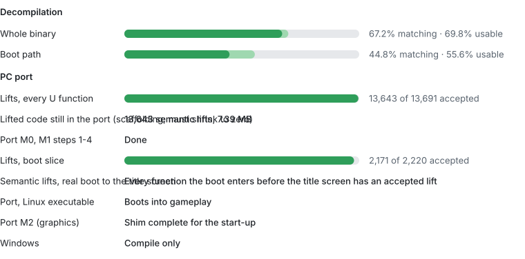

# dread-decomp

A full, human-readable decompilation of **Metroid Dread** (Nintendo Switch, version 2.1.0) and a
true source port. It is modelled on [PrimeDecomp](https://github.com/PrimeDecomp/prime) and
[zeldaret/botw](https://github.com/zeldaret/botw): C++ that compiles, with the original compiler
and flags, to the same bytes as the game's `main` executable, function by function.

**Purpose.** The project is complete when anyone can build a native port for their operating system
from their own files (keys, ROM, filesystem); nothing of the game is hosted or handed out here. It is
deliberately different from the static recompilation "Metroid Dread Recomp": no translation layer in
the product. The aim is a tool that deepens the community's understanding of a game they already own:
speedrunners reading the real code to find new methods, developers making mods that would otherwise
be impossible. Readable, matching code is the measure of completion, whoever or whatever wrote it; the lifted
code the port runs today is scaffolding, reported in [`docs/HANDOFF.md`](docs/HANDOFF.md) until it is gone.

**This repository contains no game data.** No executables, assets, keys, firmware or assembly
listings are stored here, and none will be accepted. To build and check anything you need your
own copy of the game, dumped from a console you own. The tools verify that your dump is the
expected version (`data/hashes.json`) before using it.

## Status

<!-- status:begin -->
<!-- Generated by tools/status_card.py --write; rerun it rather than edit. -->

**Matched**: code bytes that compile to the original's (the game's own code; libraries excluded). **Finished**: matched and readable, hand-typed code, the project's real metric; generated code verifies but does not count. **Untouched**: not decompiled at all. The boot path is everything `nnMain` reaches by direct calls. Lifted code is machine translation the port runs until matching code replaces it.
<!-- status:end -->

Progress is measured over the game's own code (libraries excluded) by `tools/progress.py`:
`--quality` reports matched and readable apart, and `--slice boot` the boot path (everything
reachable from `nnMain`), which has no priority while the port is on hold.
Current numbers, what each part of the tree is and what to work on next are in
[`docs/HANDOFF.md`](docs/HANDOFF.md); the route from matching source to a running PC build, and
what it needs, is in [`docs/PORT_PLAN.md`](docs/PORT_PLAN.md); the history is in
[`docs/JOURNAL.md`](docs/JOURNAL.md).

Much of the matching code so far is **generated** from the binary by the tools in `tools/`
(reflection boilerplate, descriptor constructors, small functions lifted from their
instructions, repeated template instantiations) and verified byte for byte. It counts as
finished once its text reads as source, as hand-written code does. Generated
directories (`src/reflection/`, `src/reflection_types/`, `src/reflection_statics/`,
`src/clones/`, `src/tables/`, `src/lifted/`) are regenerated, never edited by hand.

## Getting started

See [`CONTRIBUTING.md`](CONTRIBUTING.md): how to fork, set up the toolchain and your dump, check
your changes and open a pull request. The full list of commands is in [`CLAUDE.md`](CLAUDE.md)
(the project's working rules, written for both humans and AI assistants).

## Legal

This is an independent project, not affiliated with or endorsed by Nintendo or MercurySteam.
"Metroid" is a trademark of Nintendo. The code here is our own reconstruction, released under
the [MIT License](LICENSE). Vendored and referenced third-party code keeps its own license
(see [`docs/references.md`](docs/references.md)).

If you are a rights holder and have a concern about this repository, please open an issue or
contact the maintainer through GitHub.
